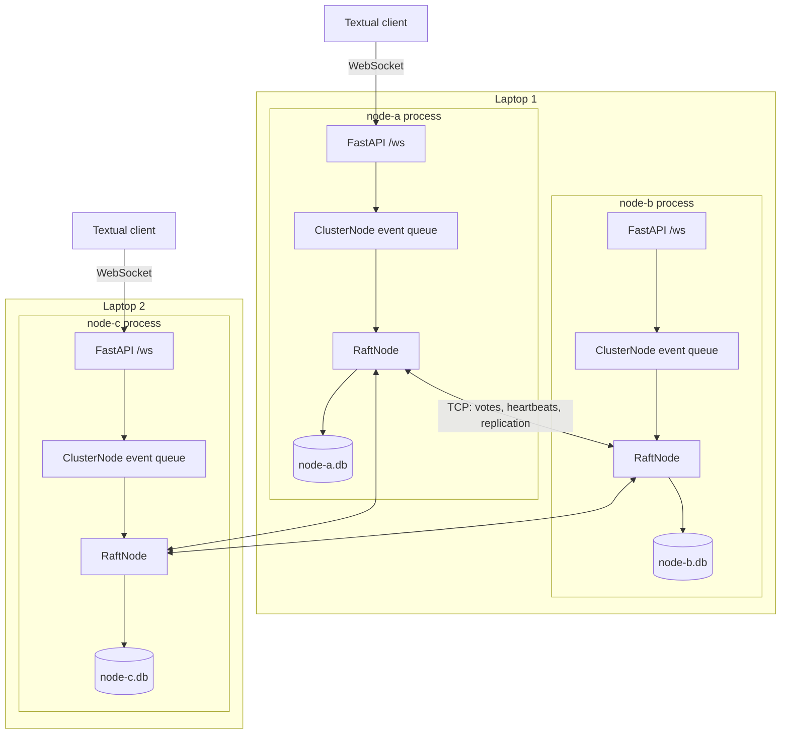
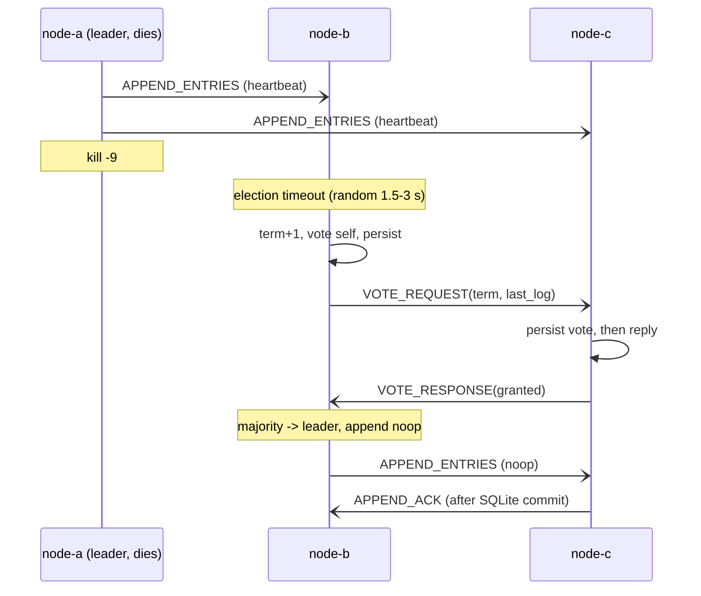
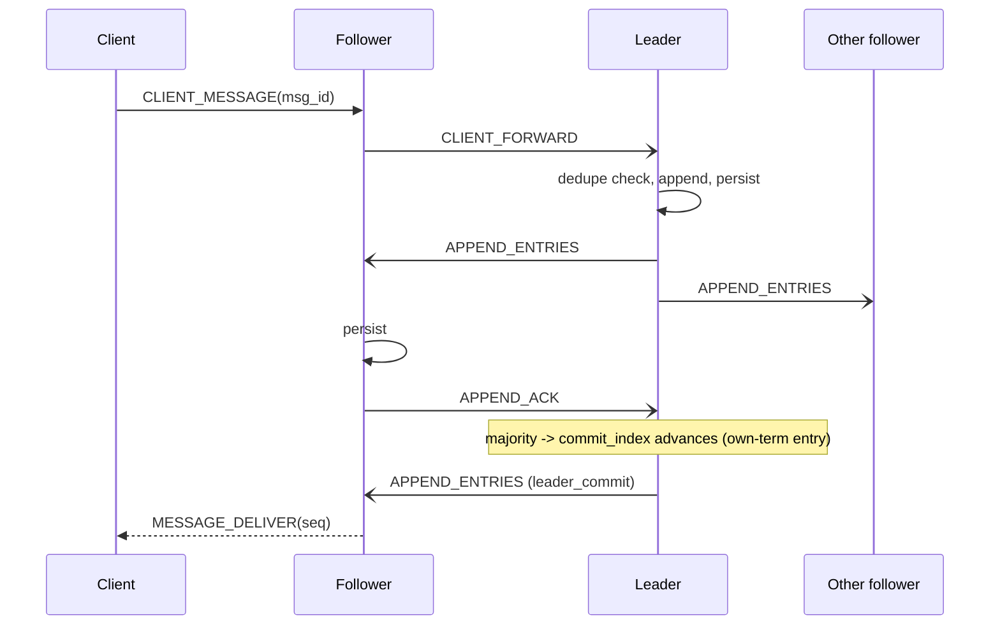

# Architecture

## Modules (one responsibility each)

| Path | Responsibility |
|---|---|
| `protocol/framing.py` | length-prefixed JSON, partial reads, oversize/malformed handling |
| `protocol/messages.py`, `client_messages.py` | Pydantic wire models, discriminated unions |
| `node/raft/core.py` | election, replication, commit rule, membership (pure logic, injected Clock/Transport/Storage) |
| `node/raft/log.py` | in-memory log, dedupe table, config index |
| `node/raft/storage.py`, `sqlite_storage.py` | Storage interface; in-memory and aiosqlite (WAL, synchronous=FULL) |
| `node/network/tcp.py` | asyncio TCP server + per-peer links with reconnect/backoff, bounded queues |
| `node/cluster/discovery.py` | seed-based join loop |
| `node/runtime.py` | wiring, single event queue, TaskGroup, shutdown |
| `node/api/session.py` | WebSocket client protocol (framework-free) |
| `node/api/ws_server.py` | FastAPI adapter + embedded uvicorn |
| `node/api/hub.py` | per-client delivery cursors (ordered delivery buffer) |
| `client/ws_client.py`, `app.py` | reconnecting client logic; Textual UI |

## Concurrency model

One event loop per node. Every state-touching event (peer message, 50 ms tick, client submit) is
put on one queue and handled strictly one at a time, so consensus state needs no locks and a
handler's `await` on SQLite cannot interleave with another handler. Outbound sends are
non-blocking (bounded per-peer queues, oldest dropped). A handler exception is fatal by design: the
node stops and recovers from disk on restart. Timeouts use `time.monotonic()`; election timeouts are
randomized with a seedable `random.Random`.

## Ordered delivery

Committed chat entries are applied to an append-only list. Each connected client has a cursor into
that list and is pushed `list[cursor:]` in order, so entry 105 can never overtake 104 and a client
that reconnects (to any node) with `last_seen_seq` receives exactly what it missed.

## Election sequence

## Replication sequence

