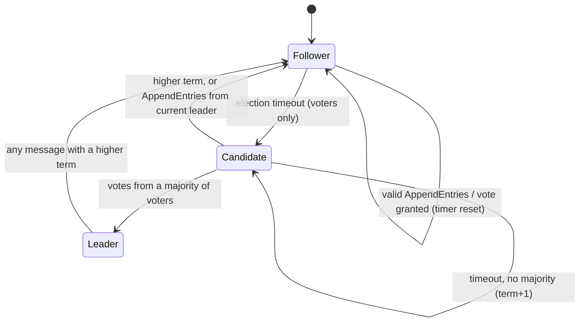

# Protocol

Server-to-server: TCP, frame = **4-byte big-endian length + UTF-8 JSON object**, max 1 MiB.
Client-to-server: WebSocket text frames (JSON). All models are Pydantic v2, discriminated on `type`.
Ordering comes from `(term, index)` in the replicated log, never from timestamps.

## Deviations from the blueprint's message list (intentional, simpler)

| Blueprint name | What this implementation does |
|---|---|
| `HEARTBEAT` | An empty `APPEND_ENTRIES` (blueprint allows this) |
| `COMMIT_INDEX` | The `leader_commit` field of `APPEND_ENTRIES` (also pushed immediately when it advances) |
| `SYNC_REQUEST/RESPONSE` | Raft log repair: failed `APPEND_ACK` carries `conflict_index`, leader backs up and resends. A restarted/new node catches up by log replay |
| `MEMBERSHIP_RESPONSE` | `JOIN_RESPONSE` (+ membership is replicated as `config` log entries) |
| `LEADER_ANNOUNCE` | Implicit: first `APPEND_ENTRIES` of a term. Clients see it in `WELCOME` / `NODE_STATUS` |
| `ELECTION_START` | Omitted (allowed by blueprint); a candidate just sends `VOTE_REQUEST` |
| `CLIENT_MESSAGE` | Client -> node over WebSocket. Between servers a follower relays it as `CLIENT_FORWARD` |

## Peer messages (every message has `version`, `sender`, `term`)

| `type` | Extra fields | Purpose |
|---|---|---|
| `PEER_HELLO` | `addr` | First frame on every connection; announces the sender's advertised address |
| `JOIN_REQUEST` | `addr` | Newcomer asks to join (sent to seeds, redirected to the leader) |
| `JOIN_RESPONSE` | `accepted`, `status` (`learner_added`/`member`/`busy`/`not_leader`), `leader_id`, `leader_addr`, `voters`, `learners` | Join result / redirect |
| `VOTE_REQUEST` | `last_log_index`, `last_log_term` | Candidate asks for a vote |
| `VOTE_RESPONSE` | `granted` | Vote decision |
| `APPEND_ENTRIES` | `prev_log_index`, `prev_log_term`, `entries[]`, `leader_commit` | Replication, heartbeat, commit index |
| `APPEND_ACK` | `success`, `match_index`, `conflict_index` | Sent only after entries are durable in SQLite |
| `CLIENT_FORWARD` | `msg_id`, `user`, `text`, `ts` | Follower hands a client message to the leader |
| `FORWARD_RESPONSE` | `msg_id`, `status`, `index`, `leader_id` | Diagnostic result of a forward |

`LogEntry`: `index`, `term`, `kind` (`chat` / `noop` / `config`), `msg_id`, `user`, `text`, `ts`,
`voters{id:addr}`, `learners{id:addr}`. A `config` entry is a full membership snapshot and takes
effect as soon as it is appended (Raft single-server change rule).

## Client messages

Client -> server: `CLIENT_HELLO{user, last_seen_seq}`, `CLIENT_MESSAGE{msg_id, text}`.
Server -> client: `WELCOME{node_id, role, term, leader_id}`, `CLIENT_ACK{msg_id, status}`
(`accepted`/`duplicate`/`forwarded`/`no_leader`), `MESSAGE_DELIVER{seq, index, msg_id, user, text, ts}`,
`NODE_STATUS{...}` (every second), `ERROR{code, detail}`.

`seq` is a gap-free chat sequence (count of committed `chat` entries), identical on every node. It
is what clients use for ordering and for `last_seen_seq` catch-up. `MESSAGE_DELIVER` carrying your
`msg_id` is the final confirmation; until then the client keeps resending the same `msg_id`.

## Node state machine

Learners and nodes not yet in any config are permanent followers: they never start elections and
never vote.

## Rules enforced (each has a test)

1. Any message with a higher term: adopt it, clear the vote, become follower.
2. `current_term`/`voted_for` are written to SQLite before a vote is granted or a candidacy announced.
3. Vote granted only if `(candidate.last_log_term, last_log_index) >= (ours)` and no other vote this term.
4. Entries are written to SQLite before `APPEND_ACK`, and before the leader counts its own copy.
5. Followers reject `APPEND_ENTRIES` whose `(prev_log_index, prev_log_term)` does not match; the leader backs up using `conflict_index`.
6. A leader advances `commit_index` only over entries of **its own term**, by counting replicas on voters; older entries commit indirectly. A new leader appends a `noop` so this can happen.
7. A follower never truncates at or below its `commit_index` (raises instead).
8. Clients are deduplicated by `msg_id`; the dedupe table is rebuilt from the log on startup.
9. Membership: newcomer -> learner (config entry) -> catches up (`match_index >= commit_index`) -> promoted (second config entry). One change at a time; none before the leader has committed an entry of its own term.

## Guarantees and limits

Promised: all clients see committed messages in the same order, no duplicates, and a surviving
majority continues after a crash (under crash-recovery with durable disks and eventually-reliable
links).
Not promised: writes without a majority; no snapshots/compaction (catch-up = log replay); no
pre-vote or check-quorum (a node that was partitioned and returns with a higher term can force one
extra election, never a safety violation); no node removal; no TLS/auth.
